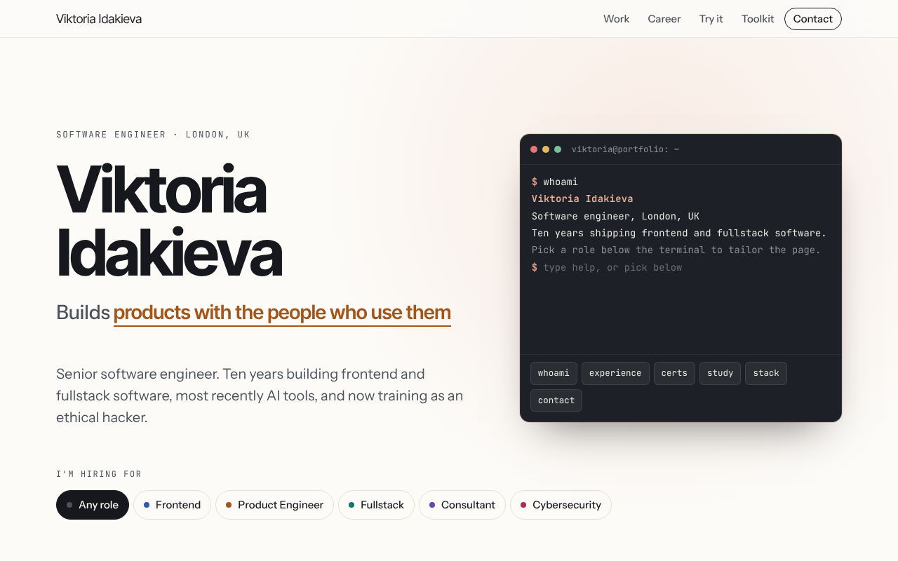
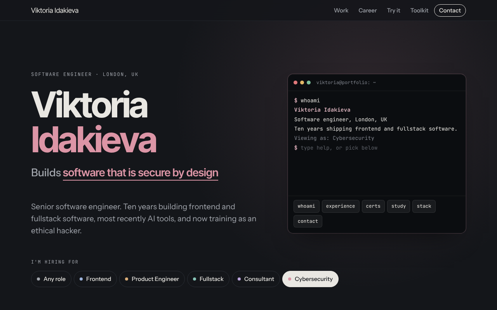
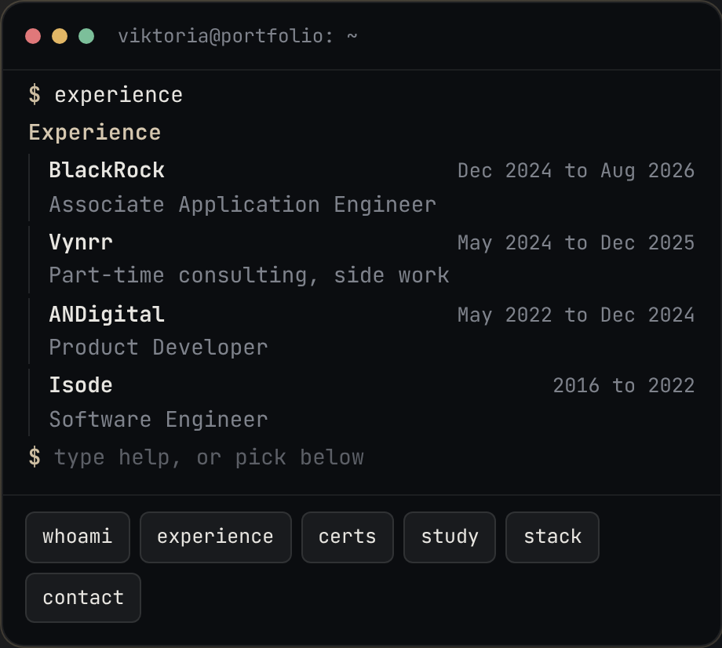
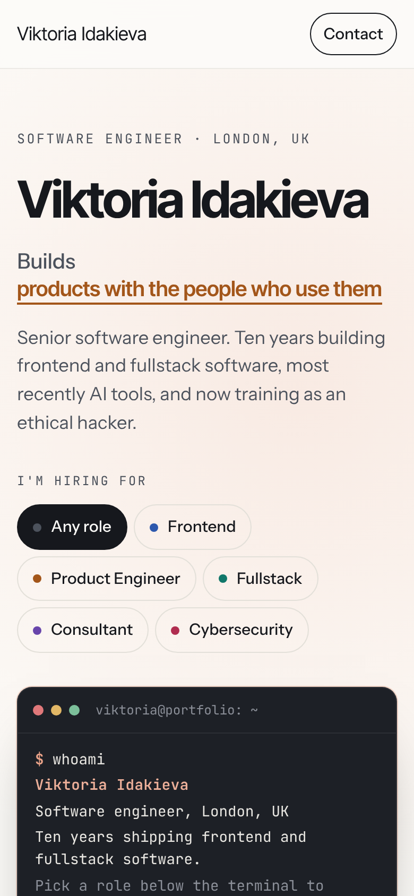

# Viktoria Idakieva, portfolio

The source of [viktoriaidakieva.co.uk](https://viktoriaidakieva.co.uk): a portfolio that rearranges itself for the role you're hiring for, with a small Claude assistant that answers questions about Viktoria's work and matches a pasted job ad against the CV.



| Dark mode, Cybersecurity lens | Header terminal | Phone |
| --- | --- | --- |
|  |  |  |

## What it does

- **Role lens.** Pick Frontend, Product Engineer, Fullstack, Consultant or Cybersecurity and the page reorders its experience, highlights the relevant tools and recolours itself. Links like `/?role=appsec` open with a lens already set.
- **Header terminal.** Visitors can type or click commands (`whoami`, `experience`, `certs`, `stack`, `contact`, `sudo hire viktoria`) to explore the CV.
- **Spot the vulnerability.** A short interactive code review exercise.
- **Ask an AI.** Questions are answered only from the CV in `src/content/profile.ts`, with links to the evidence behind each claim. A job match mode marks each requirement in a pasted job ad as Strong, Partial or Gap.

## Stack

Next.js 15 (App Router), React 19, TypeScript, plain CSS with design tokens, the Anthropic TypeScript SDK, Zod and Upstash Redis. Hosted on Vercel.

## Security and cost controls

The AI endpoint is public, so it is treated as untrusted input that costs money.

| Concern | Control | Where |
| --- | --- | --- |
| Script injection | Every piece of user and model text is rendered as React text, never HTML. AI citations only link to known evidence ids. | `Assistant.tsx`, `Terminal.tsx` |
| Terminal input | NFKC normalised, printable ASCII only, 40 characters, matched against a fixed command list. | `Terminal.tsx` |
| Third-party scripts and framing | Strict Content Security Policy (self only), `X-Frame-Options: DENY`, `nosniff`, a locked-down Permissions-Policy. | `next.config.ts` |
| Cross-site use of the API | Same-origin check, JSON content type required, 16 KB body cap before parsing. | `api/ask/route.ts` |
| Malformed input | Zod schemas with length limits on every field. | `lib/ai.ts` |
| Prompt injection | Visitor text is wrapped and labelled as data. The model answers only from the profile, never reveals contact details beyond the public ones, and job matches are validated against a schema. Invented evidence ids are removed. | `lib/ai.ts` |
| Runaway cost | Per-visitor limits (6 per 10 minutes, 30 per day), a site-wide cap of 1,500 answers per day, a daily token budget and per-answer `max_tokens`. Production without Redis keeps the AI off (fails closed). Setting the Redis key `ai:off` to `1` switches it off instantly. | `lib/guard.ts` |
| Secrets | The API key exists only as a Vercel environment variable on the server. The browser never talks to Anthropic. | `api/ask/route.ts` |
| Dependencies | CI runs `npm audit` on production dependencies, and Dependabot opens weekly update PRs. | `.github/` |

## Project layout

```
src/content/profile.ts    All CV content. The page and the AI both read it.
src/components/           Portfolio (layout and lens), Showcase (sections), Terminal, Assistant
src/app/api/ask/route.ts  The AI endpoint: pitch, chat (streamed) and job match (structured JSON)
src/lib/ai.ts             System prompt, input schemas, prompts and output checks
src/lib/guard.ts          Rate limits, token budget and kill switch
next.config.ts            Security headers
```

## Run locally

```
npm install
cp .env.example .env.local   # add ANTHROPIC_API_KEY to try the assistant
npm run dev
```

Without Redis, local development skips the rate limits. Without an API key, the rest of the site works and the assistant shows a friendly message.

## Deploy

1. Import the repository in Vercel.
2. Add `ANTHROPIC_API_KEY` for Production. Use a dedicated Anthropic workspace with a monthly spend limit.
3. Add Upstash for Redis from the Vercel Storage tab. It sets `KV_REST_API_URL` and `KV_REST_API_TOKEN`.
4. Optional settings: `CLAUDE_MODEL` (default `claude-opus-5-5`), `DAILY_TOKEN_BUDGET` (default 250000) and `AI_DISABLED=1`.

## Licence

The code is MIT licensed. The CV content, certification badges and screenshots are not licensed for reuse. See [LICENSE](LICENSE).
